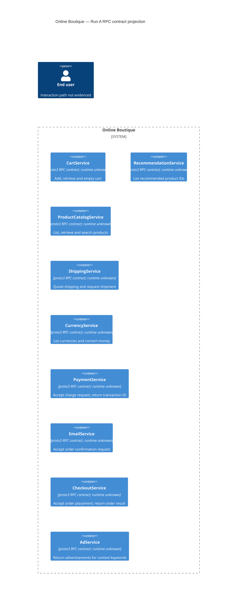

# Architecture recovery — Run A

## 1. Agent

Codex; model family: GPT-6.1-SOL.

## 2. Files read

- `AGENTS.md`
- `prompts/1-recover-architecture.md`
- `system/online-boutique/protos/demo.proto`

## 3. Containers table

The service rows below represent the nine declared RPC interfaces. Their mapping to independently deployed containers is **not evidenced in the provided files**. The contract uses Protocol Buffers `proto3` (`system/online-boutique/protos/demo.proto:15`); implementation languages and runtime technologies are not evidenced. Message types are not evidence of data stores.

| Name | Technology/language | Responsibility declared by the interface | Evidence |
|---|---|---|---|
| CartService | proto3 RPC contract; runtime unknown | Add an item, retrieve a cart, empty a cart | `system/online-boutique/protos/demo.proto:23–27`, `CartService.AddItem/GetCart/EmptyCart` |
| RecommendationService | proto3 RPC contract; runtime unknown | List recommended product IDs | `system/online-boutique/protos/demo.proto:56–67`, `RecommendationService.ListRecommendations` |
| ProductCatalogService | proto3 RPC contract; runtime unknown | List, retrieve, and search products | `system/online-boutique/protos/demo.proto:71–75`, `ProductCatalogService.ListProducts/GetProduct/SearchProducts` |
| ShippingService | proto3 RPC contract; runtime unknown | Quote shipping and request shipment with a tracking ID response | `system/online-boutique/protos/demo.proto:107–128`, `ShippingService.GetQuote/ShipOrder` |
| CurrencyService | proto3 RPC contract; runtime unknown | List supported currencies and convert money | `system/online-boutique/protos/demo.proto:140–143`, `CurrencyService.GetSupportedCurrencies/Convert` |
| PaymentService | proto3 RPC contract; runtime unknown | Accept a charge request and return a transaction ID | `system/online-boutique/protos/demo.proto:177–195`, `PaymentService.Charge` |
| EmailService | proto3 RPC contract; runtime unknown | Accept an order confirmation request for an email address | `system/online-boutique/protos/demo.proto:199–201,216–219`, `EmailService.SendOrderConfirmation` |
| CheckoutService | proto3 RPC contract; runtime unknown | Accept an order placement request and return an order result | `system/online-boutique/protos/demo.proto:224–239`, `CheckoutService.PlaceOrder` |
| AdService | proto3 RPC contract; runtime unknown | Return advertisements for context keywords | `system/online-boutique/protos/demo.proto:243–261`, `AdService.GetAds` |

## 4. Dependencies table

| Caller -> callee | Protocol | Evidence |
|---|---|---|

No runtime dependencies are evidenced. `system/online-boutique/protos/demo.proto` declares callable interfaces but identifies no callers or client wiring. Shared messages such as `Money`, `CartItem`, and `OrderResult` do not establish service calls. Actual transport is **not evidenced in the provided files**.

## 5. Mermaid diagram

This contract-level projection matches the service rows above; it does not establish deployment boundaries. The required end-user symbol is unconnected because no interaction path is evidenced. There are no dependency rows and therefore no `Rel` statements.

## 6. Gaps

Exact additional filenames are not evidenced; the requested files below describe the evidence needed, without asserting that they exist.

| Gap | Additional file needed to settle it |
|---|---|
| Independently deployed containers, runtime languages, and endpoint addresses: **Not evidenced in the provided files**. | A deployment manifest defining these service workloads, plus their build files or entrypoints. |
| Caller -> callee dependencies, actual transport, and checkout orchestration: **Not evidenced in the provided files**. | Each relevant service implementation file containing client construction and outbound call sites; server bootstrap for transport confirmation. |
| User entry point and interaction protocol: **Not evidenced in the provided files**. | The user-facing entrypoint implementation and its routing or ingress configuration. |
| Data stores, brokers, and external providers: **Not evidenced in the provided files**. | Persistence/provider initialization code and corresponding deployment configuration. |
