## 1. Agent

Codex; model: GPT-6.1 Sol (identified by the student). Run: B. Language: English (default).

## 2. Files read

- `AGENTS.md`
- `prompts/1-recover-architecture.md`
- `system/online-boutique/protos/demo.proto`
- `system/online-boutique/kubernetes-manifests/README.md`
- `system/online-boutique/kubernetes-manifests/adservice.yaml`
- `system/online-boutique/kubernetes-manifests/cartservice.yaml`
- `system/online-boutique/kubernetes-manifests/checkoutservice.yaml`
- `system/online-boutique/kubernetes-manifests/currencyservice.yaml`
- `system/online-boutique/kubernetes-manifests/emailservice.yaml`
- `system/online-boutique/kubernetes-manifests/frontend.yaml`
- `system/online-boutique/kubernetes-manifests/kustomization.yaml`
- `system/online-boutique/kubernetes-manifests/loadgenerator.yaml`
- `system/online-boutique/kubernetes-manifests/paymentservice.yaml`
- `system/online-boutique/kubernetes-manifests/productcatalogservice.yaml`
- `system/online-boutique/kubernetes-manifests/recommendationservice.yaml`
- `system/online-boutique/kubernetes-manifests/shippingservice.yaml`

## 3. Containers table

These are declarations and API contracts, not observations of a running system. Application implementation languages are **Not evidenced in the provided files**. RPC responsibilities describe exposed contracts, not proof of real-world fulfillment. Kubernetes Services and ServiceAccounts are infrastructure objects, not additional C4 containers.

| Name | Technology/language | Responsibility | Evidence |
|---|---|---|---|
| `frontend` | HTTP; implementation language not evidenced | HTTP entry point | `system/online-boutique/kubernetes-manifests/frontend.yaml` (Deployment, image `frontend`, HTTP probes, `frontend-external` LoadBalancer) |
| `cartservice` | gRPC; implementation language not evidenced | Add, retrieve and empty user carts | `system/online-boutique/kubernetes-manifests/cartservice.yaml` (Deployment; Service port `grpc`); `system/online-boutique/protos/demo.proto` (`CartService.AddItem/GetCart/EmptyCart`) |
| `productcatalogservice` | gRPC; implementation language not evidenced | List, retrieve and search products | `system/online-boutique/kubernetes-manifests/productcatalogservice.yaml` (Deployment; Service port `grpc`); `system/online-boutique/protos/demo.proto` (`ProductCatalogService.ListProducts/GetProduct/SearchProducts`) |
| `recommendationservice` | gRPC; implementation language not evidenced | Return recommended product IDs | `system/online-boutique/kubernetes-manifests/recommendationservice.yaml` (Deployment; Service port `grpc`); `system/online-boutique/protos/demo.proto` (`RecommendationService.ListRecommendations`, `ListRecommendationsResponse.product_ids`) |
| `shippingservice` | gRPC; implementation language not evidenced | Expose shipping quote and ship-order operations | `system/online-boutique/kubernetes-manifests/shippingservice.yaml` (Deployment; Service port `grpc`); `system/online-boutique/protos/demo.proto` (`ShippingService.GetQuote/ShipOrder`) |
| `currencyservice` | gRPC; implementation language not evidenced | List supported currencies and convert money | `system/online-boutique/kubernetes-manifests/currencyservice.yaml` (Deployment; Service port `grpc`); `system/online-boutique/protos/demo.proto` (`CurrencyService.GetSupportedCurrencies/Convert`) |
| `paymentservice` | gRPC; implementation language not evidenced | Expose a credit-card charge operation | `system/online-boutique/kubernetes-manifests/paymentservice.yaml` (Deployment; Service port `grpc`); `system/online-boutique/protos/demo.proto` (`PaymentService.Charge`, `ChargeRequest.credit_card`) |
| `emailservice` | gRPC; implementation language not evidenced | Expose an order-confirmation email operation | `system/online-boutique/kubernetes-manifests/emailservice.yaml` (Deployment; Service port `grpc`); `system/online-boutique/protos/demo.proto` (`EmailService.SendOrderConfirmation`) |
| `checkoutservice` | gRPC; implementation language not evidenced | Expose order placement | `system/online-boutique/kubernetes-manifests/checkoutservice.yaml` (Deployment; Service port `grpc`); `system/online-boutique/protos/demo.proto` (`CheckoutService.PlaceOrder`) |
| `adservice` | gRPC; implementation language not evidenced | Return advertisements for contextual keywords | `system/online-boutique/kubernetes-manifests/adservice.yaml` (Deployment; Service port `grpc`); `system/online-boutique/protos/demo.proto` (`AdService.GetAds`, `AdRequest.context_keys`) |
| `redis-cart` | Redis (redis:alpine) | Redis endpoint configured for cartservice | `system/online-boutique/kubernetes-manifests/cartservice.yaml` (`REDIS_ADDR=redis-cart:6379`; Deployment `redis-cart`; image `redis:alpine`; `/data` volume `emptyDir`) |
| `loadgenerator` | Container image loadgenerator; language/framework not evidenced | Configured frontend client with startup HTTP reachability check | `system/online-boutique/kubernetes-manifests/loadgenerator.yaml` (Deployment, image `loadgenerator`, `FRONTEND_ADDR`, `USERS`, `RATE`, initContainer `frontend-check`); `system/online-boutique/kubernetes-manifests/kustomization.yaml` (resource commented out) |

`loadgenerator` is included because its Deployment is provided, but its resource is commented out in `system/online-boutique/kubernetes-manifests/kustomization.yaml`; that comment refers to a Skaffold module. Its inclusion in an actual deployment is not established.

## 4. Dependencies table

Service-to-service rows are **configured endpoint dependencies**: caller environment variables identify targets; target Service port names and the RPC contracts establish advertised protocols. They do not establish that a call occurs, which RPC is invoked, or its ordering. Protocol ports below are Service ports, with explicit target-port translation where different. No running traffic was inspected.

| Caller -> callee | Protocol | Evidence |
|---|---|---|
| End user -> frontend | HTTP :80 -> :8080 | `system/online-boutique/kubernetes-manifests/frontend.yaml` (`frontend-external`: `type: LoadBalancer`, port `http:80`, `targetPort:8080`); user access is inferred from this exposure |
| frontend -> productcatalogservice | gRPC :3550 | `system/online-boutique/kubernetes-manifests/frontend.yaml` (`PRODUCT_CATALOG_SERVICE_ADDR=productcatalogservice:3550`); `system/online-boutique/kubernetes-manifests/productcatalogservice.yaml` (Service port `grpc`) |
| frontend -> currencyservice | gRPC :7000 | `system/online-boutique/kubernetes-manifests/frontend.yaml` (`CURRENCY_SERVICE_ADDR=currencyservice:7000`); `system/online-boutique/kubernetes-manifests/currencyservice.yaml` (Service port `grpc`) |
| frontend -> cartservice | gRPC :7070 | `system/online-boutique/kubernetes-manifests/frontend.yaml` (`CART_SERVICE_ADDR=cartservice:7070`); `system/online-boutique/kubernetes-manifests/cartservice.yaml` (Service port `grpc`) |
| frontend -> recommendationservice | gRPC :8080 | `system/online-boutique/kubernetes-manifests/frontend.yaml` (`RECOMMENDATION_SERVICE_ADDR=recommendationservice:8080`); `system/online-boutique/kubernetes-manifests/recommendationservice.yaml` (Service port `grpc`) |
| frontend -> shippingservice | gRPC :50051 | `system/online-boutique/kubernetes-manifests/frontend.yaml` (`SHIPPING_SERVICE_ADDR=shippingservice:50051`); `system/online-boutique/kubernetes-manifests/shippingservice.yaml` (Service port `grpc`) |
| frontend -> checkoutservice | gRPC :5050 | `system/online-boutique/kubernetes-manifests/frontend.yaml` (`CHECKOUT_SERVICE_ADDR=checkoutservice:5050`); `system/online-boutique/kubernetes-manifests/checkoutservice.yaml` (Service port `grpc`) |
| frontend -> adservice | gRPC :9555 | `system/online-boutique/kubernetes-manifests/frontend.yaml` (`AD_SERVICE_ADDR=adservice:9555`); `system/online-boutique/kubernetes-manifests/adservice.yaml` (Service port `grpc`) |
| checkoutservice -> productcatalogservice | gRPC :3550 | `system/online-boutique/kubernetes-manifests/checkoutservice.yaml` (`PRODUCT_CATALOG_SERVICE_ADDR=productcatalogservice:3550`); `system/online-boutique/kubernetes-manifests/productcatalogservice.yaml` (Service port `grpc`) |
| checkoutservice -> shippingservice | gRPC :50051 | `system/online-boutique/kubernetes-manifests/checkoutservice.yaml` (`SHIPPING_SERVICE_ADDR=shippingservice:50051`); `system/online-boutique/kubernetes-manifests/shippingservice.yaml` (Service port `grpc`) |
| checkoutservice -> paymentservice | gRPC :50051 | `system/online-boutique/kubernetes-manifests/checkoutservice.yaml` (`PAYMENT_SERVICE_ADDR=paymentservice:50051`); `system/online-boutique/kubernetes-manifests/paymentservice.yaml` (Service port `grpc`) |
| checkoutservice -> emailservice | gRPC :5000 -> :8080 | `system/online-boutique/kubernetes-manifests/checkoutservice.yaml` (`EMAIL_SERVICE_ADDR=emailservice:5000`); `system/online-boutique/kubernetes-manifests/emailservice.yaml` (Service port `grpc`, `port:5000`, `targetPort:8080`) |
| checkoutservice -> currencyservice | gRPC :7000 | `system/online-boutique/kubernetes-manifests/checkoutservice.yaml` (`CURRENCY_SERVICE_ADDR=currencyservice:7000`); `system/online-boutique/kubernetes-manifests/currencyservice.yaml` (Service port `grpc`) |
| checkoutservice -> cartservice | gRPC :7070 | `system/online-boutique/kubernetes-manifests/checkoutservice.yaml` (`CART_SERVICE_ADDR=cartservice:7070`); `system/online-boutique/kubernetes-manifests/cartservice.yaml` (Service port `grpc`) |
| recommendationservice -> productcatalogservice | gRPC :3550 | `system/online-boutique/kubernetes-manifests/recommendationservice.yaml` (`PRODUCT_CATALOG_SERVICE_ADDR=productcatalogservice:3550`); `system/online-boutique/kubernetes-manifests/productcatalogservice.yaml` (Service port `grpc`) |
| cartservice -> redis-cart | Redis/TCP :6379 | `system/online-boutique/kubernetes-manifests/cartservice.yaml` (`REDIS_ADDR=redis-cart:6379`; Redis image and Service port `tcp-redis:6379`); exact Redis commands are not evidenced |
| loadgenerator -> frontend | HTTP :80 -> :8080 | `system/online-boutique/kubernetes-manifests/loadgenerator.yaml` (`FRONTEND_ADDR=frontend:80`, initContainer `frontend-check`: `wget ... http://${FRONTEND_ADDR}`); `system/online-boutique/kubernetes-manifests/frontend.yaml` (Service `frontend`, `port:80`, `targetPort:8080`) |

## 5. Mermaid diagram

The diagram contains exactly the 12 container rows and 17 relationship rows above. No external system is established by the provided evidence.

```mermaid
C4Container
  title Online Boutique: configured architecture (Run B)
  Person(user, "End user", "Accesses the exposed HTTP endpoint [Inferred]")
  System_Boundary(shop, "Online Boutique") {
    Container(frontend, "frontend", "HTTP; implementation language not evidenced", "HTTP entry point")
    Container(cartservice, "cartservice", "gRPC; implementation language not evidenced", "Add, retrieve and empty user carts")
    Container(productcatalogservice, "productcatalogservice", "gRPC; implementation language not evidenced", "List, retrieve and search products")
    Container(recommendationservice, "recommendationservice", "gRPC; implementation language not evidenced", "Return recommended product IDs")
    Container(shippingservice, "shippingservice", "gRPC; implementation language not evidenced", "Expose shipping quote and ship-order operations")
    Container(currencyservice, "currencyservice", "gRPC; implementation language not evidenced", "List supported currencies and convert money")
    Container(paymentservice, "paymentservice", "gRPC; implementation language not evidenced", "Expose a credit-card charge operation")
    Container(emailservice, "emailservice", "gRPC; implementation language not evidenced", "Expose an order-confirmation email operation")
    Container(checkoutservice, "checkoutservice", "gRPC; implementation language not evidenced", "Expose order placement")
    Container(adservice, "adservice", "gRPC; implementation language not evidenced", "Return advertisements for contextual keywords")
    ContainerDb(redis_cart, "redis-cart", "Redis (redis:alpine)", "Redis endpoint configured for cartservice")
    Container(loadgenerator, "loadgenerator", "Container image loadgenerator; language/framework not evidenced", "Configured frontend client with startup HTTP reachability check")
  }
  Rel(user, frontend, "Accesses configured external endpoint [Inferred]", "HTTP :80 -> :8080")
  Rel(frontend, productcatalogservice, "Accesses product catalog (configured)", "gRPC :3550")
  Rel(frontend, currencyservice, "Accesses currency operations (configured)", "gRPC :7000")
  Rel(frontend, cartservice, "Accesses cart operations (configured)", "gRPC :7070")
  Rel(frontend, recommendationservice, "Accesses recommendations (configured)", "gRPC :8080")
  Rel(frontend, shippingservice, "Accesses shipping operations (configured)", "gRPC :50051")
  Rel(frontend, checkoutservice, "Accesses order placement (configured)", "gRPC :5050")
  Rel(frontend, adservice, "Accesses advertisements (configured)", "gRPC :9555")
  Rel(checkoutservice, productcatalogservice, "Accesses product catalog (configured)", "gRPC :3550")
  Rel(checkoutservice, shippingservice, "Accesses shipping operations (configured)", "gRPC :50051")
  Rel(checkoutservice, paymentservice, "Accesses charge operation (configured)", "gRPC :50051")
  Rel(checkoutservice, emailservice, "Accesses order confirmation (configured)", "gRPC :5000 -> :8080")
  Rel(checkoutservice, currencyservice, "Accesses currency operations (configured)", "gRPC :7000")
  Rel(checkoutservice, cartservice, "Accesses cart operations (configured)", "gRPC :7070")
  Rel(recommendationservice, productcatalogservice, "Accesses product catalog (configured)", "gRPC :3550")
  Rel(cartservice, redis_cart, "Uses configured Redis endpoint", "Redis/TCP :6379")
  Rel(loadgenerator, frontend, "Targets frontend and checks startup reachability (configured)", "HTTP :80 -> :8080")
  UpdateLayoutConfig($c4ShapeInRow="3", $c4BoundaryInRow="1")
```

## 6. Gaps

| Gap | Additional file that would settle it (not read) |
|---|---|
| Actual implementation languages and frameworks: **Not evidenced in the provided files**; image names and the protobuf `go_package` option do not establish every service language. | Each application image's Dockerfile/build file; exact filenames/locations are not evidenced here. |
| Actual calls, RPC selections, execution order, error handling, retries and deadlines: **Not evidenced in the provided files**. | Caller implementation files consuming the listed address variables; exact filenames are not evidenced here. |
| `frontend.yaml` configures `SHOPPING_ASSISTANT_SERVICE_ADDR=shoppingassistantservice:80`, but no corresponding Deployment, Service or RPC contract is provided, and `ENABLE_ASSISTANT` is commented out. Active dependency, protocol and container boundary are **Not evidenced in the provided files**; excluded from tables/diagram. | The shopping-assistant component's `kustomization.yaml` and frontend enablement/configuration implementation; `kustomization.yaml` only comments a reference to `../kustomize/components/shopping-assistant`. |
| Applied topology, resolved image tags and whether the load generator is included: **Not evidenced in the provided files**. `kubernetes-manifests/README.md` says these manifests need Skaffold image substitution and points to release manifests. | The referenced `skaffold.yaml` and the final rendered/applied manifest file. |
| Live availability, successful requests and observed communication: **Not evidenced in the provided files**. Configured health probes are not probe results. | A cluster workload/status export and a request trace/log file from the deployed version. |
| Redis use beyond its configured endpoint, durable cart semantics, other stores, and external payment/email/carrier integrations: **Not evidenced in the provided files**. `cartservice.yaml` shows `/data` backed by `emptyDir`, not a persistent volume. No unproven store, broker or provider is drawn. | Cartservice Redis client/persistence implementation and payment/email/shipping integration implementation files; exact filenames are not evidenced here. |

Evidence-scope violations: none. Only the files listed in section 2 were opened; only the allowed manifests directory was enumerated. No terminal commands, implementation-source reads, other outputs, or independent dependency-verification stage were used.
